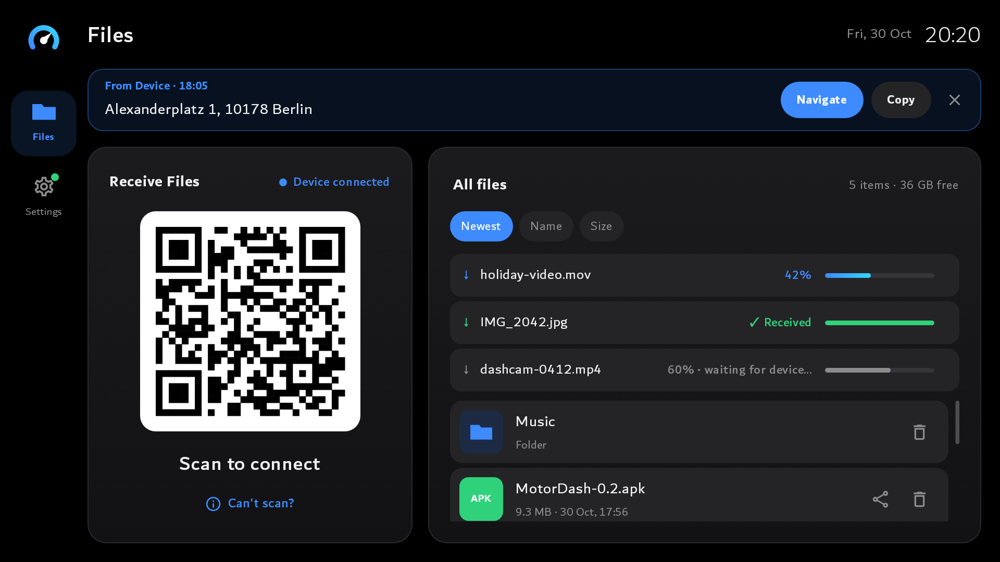
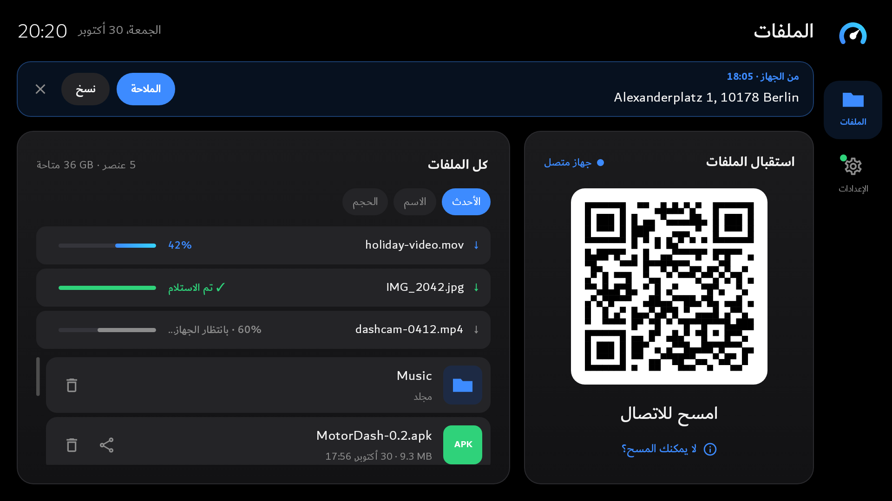
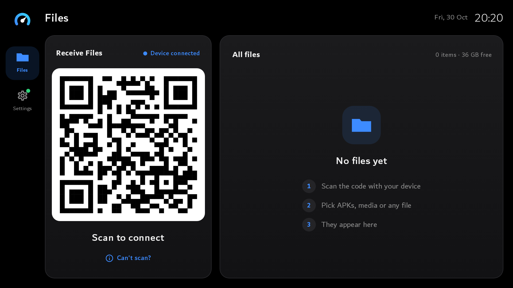

# MotorDash

Wireless file sharing for BYD DiLink car screens, with nothing to install on the other device.
The car screen runs a small web server and shows a QR code. Scan it, and any device's browser
can send files and text to the car, and fetch files back.
The device and the car must be on the same network, e.g. the car on a device's hotspot.

## Install
1. Download `MotorDash-<version>.apk` from the latest
   [release](https://github.com/mohdbk/motordash/releases/latest).
2. Copy it to a USB stick, plug it into the car and open it with the car's file manager to install.
3. Open **MotorDash**, scan the QR code with your device and send something.

After that, MotorDash updates itself: Settings → Updates.
Problems or ideas: [open an issue](https://github.com/mohdbk/motordash/issues).
The same link is in the app under Settings → About → Feedback.

  
  

## Features

**Device → car**
- **Send files.** Received files go to `Download/MotorDash` (changeable in Settings) and open (or
  install, for APKs) straight from the car screen. Photos and videos show thumbnails, APKs their
  app icon, and new arrivals are highlighted briefly. Media shows up in the car's own gallery/music apps.
- **Resumable uploads.** If the hotspot drops mid-upload, the device retries for up to 10 minutes
  and sends only the missing part. The car shows "waiting for device…" meanwhile. Re-picking the
  same file after reloading the page also resumes.
- **Send text.** Addresses, links and notes appear on the car with **Open link** (browser),
  **Navigate** (maps search) and **Copy** buttons. The last 20 are kept until the app restarts.

**Car → device**
- Each file has a share button that shows a QR code. Scanning it downloads the file.

**Connecting**
- The Receive card shows **Device connected** while a device has the page open.
- The QR code holds the car's address and a 6-digit PIN that changes every time the app starts.
- **Can't scan?** shows the address and PIN to type in instead. Opening the address shows a
  PIN page.
- With several networks (Wi-Fi + hotspot), pick the right address under
  Settings → File sharing.

**Arabic and English**
- The car follows its system language. Settings → General → Language overrides it
  (Automatic / English / العربية).
- The device's web page follows that device's language.
- Arabic is fully right-to-left: layout, navigation, progress bars, the car's own messages and
  the PIN page. Addresses, PINs, sizes and versions stay left-to-right.
- Both languages use the Dubai font.

**Settings**
- General: language.
- File sharing: address in the QR code, where files are saved (Download/ or Documents/ plus a
  folder name, optionally moving existing files), received messages.
- Updates: current version, check now, update.
- Technical Details: app version, display and file server info.

## Troubleshooting
- **The device says "Scan the QR code on the car screen again".** The app restarted (new PIN) or
  the session expired. Scan again or enter the PIN.
- **"Too many wrong PINs".** Wait 30 seconds.
- **Navigate does nothing / "No maps app".** The car's maps app doesn't accept searches from
  other apps. Use Copy instead.
- Anything else: [open an issue](https://github.com/mohdbk/motordash/issues) with a photo of the
  screen and what you did.

## Contributing
- [Development](docs/development.md): how it's built, setup with hot reload, tests.
- [Releasing](docs/releasing.md): signing, versions and betas, publishing updates.

## License
[MIT](LICENSE). The Dubai font is © Dubai Executive Council and isn't part of this repository
(see [Fonts](docs/development.md#fonts)).
